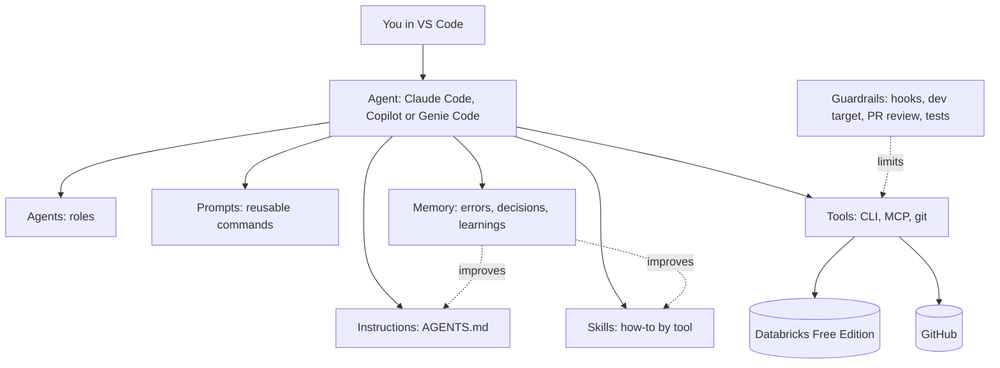
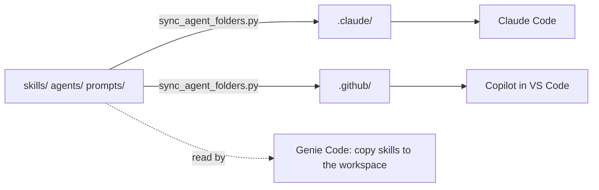

# Architecture of the harness

An agent harness is everything around the model that makes it useful and safe: instructions it reads, skills it can load, agents with a role, prompts you reuse, tools it can call, guardrails that stop it, and memory that survives the session.



## Layers

| Layer | Folder | Purpose |
|---|---|---|
| Instructions | `AGENTS.md`, `CLAUDE.md` | Rules every agent follows |
| Agents | `agents/` | A role with a scope |
| Skills | `skills/<tool>/<name>/` | Procedures and facts per tool |
| Prompts | `prompts/` | Reusable tasks you trigger |
| Guardrails | `.claude/settings.json`, hooks, CI | Stop mistakes |
| Memory | `docs/knowledge/` | What was learned, what failed |

## One source, several tools

You edit `skills/`, `agents/`, `prompts/`. A script copies them to the folders each tool expects.



Genie Code reads skills from the workspace. Whether it can read this repository's folders directly is `unverified`; test it (lab 03).

## Bronze: public contracts (US01)

One year of the IMPIC public contracts dataset (dados.gov.pt, Portal BASE) lands in `workspace.samantha_contratos_pt.bronze_contratos` (dev). One row per contract, all fields as text, plus five metadata columns (`_source_url`, `_source_modified`, `_ingested_at`, `_file_sha256`, `_source_year`). The zip is kept in the Volume `contratos_raw` with its publication date; the staging files are cleaned up. Code: `src/us01/`. Job: `resources/us01_bronze.yml` (notebook `notebooks/us01_bronze_contratos.py`, check `notebooks/check_us01_contagem.py`). Details and dev results: `docs/specs/US01-contratos-bronze.md`.

## The improvement loop

```mermaid
flowchart LR
  W[Work on a story] --> F{Failure or correction?}
  F -->|yes| L[Log in errors/LOG.md]
  L --> R[/retro/ proposes a diff]
  R --> Y{You approve?}
  Y -->|yes| E[Edit skill, agent or AGENTS.md]
  E --> W
  Y -->|no| W
  F -->|no| W
```
